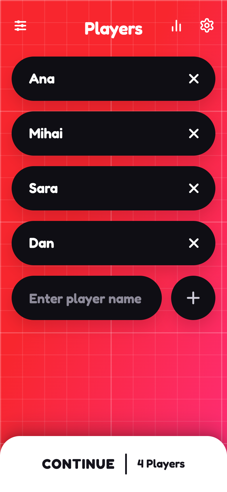
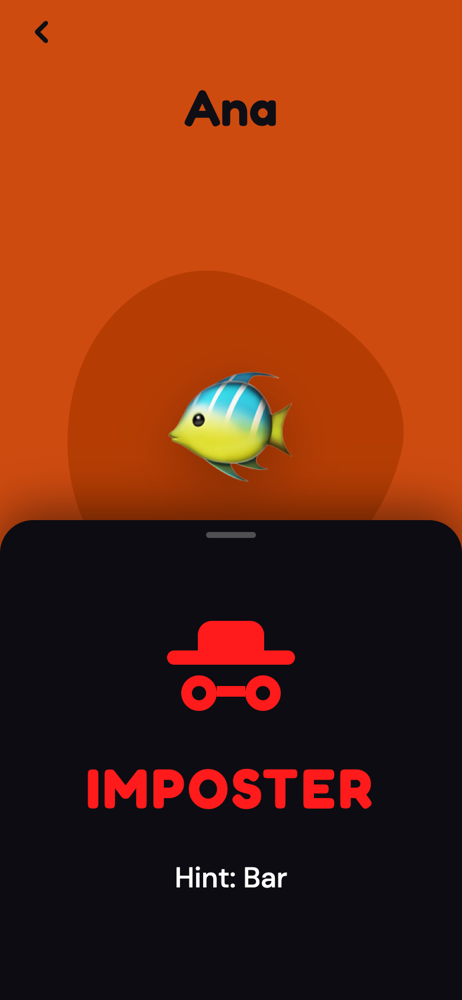

# Fake Out

Pass-the-phone party game: everyone gets the secret word except the imposters. Talk, bluff, and find the fakes.

<p>
  
  
  
</p>

## Features

- One phone, 3+ players. Each player drags the card up to peek at their word in private, then passes the phone on.
- Two modes: **Classic** (imposters get no word, only an optional hint) and **Undercover** (imposters get a different but related word).
- Freeform discussion timer or turn-by-turn speaking order, with an optional Blitz round.
- Configurable number of imposters, round length and hints.
- 9 word decks: Party Time, Food, Celebs, Hobbies, Movies & TV, Sports, Travel, Tech, Romania.
- Voting, a final reveal, and results.
- Match history, XP levels and achievements, stored locally.
- English and Romanian UI, four colour themes.
- Runs entirely in the browser — no backend, no accounts.

## Tech stack

React 19 · TypeScript · Vite · Tailwind CSS 4 · Zustand · Framer Motion · Playwright (end-to-end tests)

## Getting started

```bash
git clone https://github.com/vladiclick/fake-out.git
cd fake-out
npm install
npm run dev          # http://localhost:5173
```

Production build:

```bash
npm run build        # output in dist/
npm run preview
```

End-to-end tests (Playwright, run against the dev server):

```bash
npx playwright install chromium
npm run dev          # in one terminal
node tests/run-all-tests.mjs
```

## Status

Finished and playable. Best on a phone; add it to the home screen for a full-screen app.

## License

[MIT](LICENSE)
